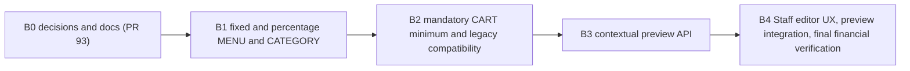

# Promotions DEC-077 — Implementation Plan (B1–B4)

Status: **Accepted plan (Product Owner, 2026-11-26; sequence and compatibility corrections 2026-11-26) — documentation only (milestone B0).**
Nothing in this file is implemented, migrated or deployed. Decision: `docs/00-product/PROJECT_DECISIONS.md` DEC-077. Domain contract:
`docs/01-domain/PROMOTIONS_SPEC.md` "Amendment DEC-077". Worked numbers: `docs/01-domain/PROMOTIONS_STACKING_EXAMPLES.md` §10–§14.
Storage: `docs/02-technical/DATABASE_SPEC.md` "Amendment 2026-11-26". API: `docs/02-technical/API_CONVENTIONS.md` #111 (planned notes).

**Label note.** B1–B4 here are the DEC-077 follow-up milestones. They are unrelated to the DEC-075 milestones of the same names
(engine, order integration, Staff workspace, Guest display), which are merged on `main` (see the status note in
`UNIFIED_PROMOTIONS_IMPLEMENTATION_PLAN.md`). Say "DEC-077 B1" … "DEC-077 B4" in branches, PR titles and commits.

**Release discipline.** Every milestone has its own branch, PR, review and **its own merge approval**; approving or merging one never
approves the next. A merge is not a deployment: each production deployment is a separate, explicit Product Owner decision and is not
mandatory after every PR. Several merged milestones may be deployed together, but only in the combinations allowed by §8. The opt-in
`PROMOTIONS` entitlement is unchanged, so only restaurants that already have it are affected.

---

## 1. Baseline (`main` `02a000c`, verified by reading the code)

- `promotion-engine.ts` marks a CATEGORY / MENU promotion that is not `PERCENTAGE` as `INVALID_CONFIGURATION` and computes item
  candidates with `'PERCENTAGE'` hard-coded.
- `validatePromotionInput` rejects fixed item scope (`ITEM_SCOPE_REQUIRES_PERCENTAGE`) and accepts a CART `minimumSubtotal` of
  `null` or ≥ 0.
- The migration `20261128100000_unified_promotions` has CHECKs `promotions_item_scope_percentage_only`,
  `order_promotions_item_scope_percentage_only` and `promotions_minimum_subtotal_shape` (`>= 0`).
- `PromotionPreviewService` runs the real engine on a first-active-size, no-extras sample with the draft treated as ACTIVE, returns
  one result, and answers an invalid draft with `422`. The web `savings-preview.ts` additionally computes an *illustrative*
  example with browser BigInt arithmetic.
- **`apps/web/src/lib/promotions/draft.ts` forces `discountType` to `PERCENTAGE` for MENU / CATEGORY** (`isPercentageOnly`) every time
  a draft is converted to a request. The editor also hides the type selector for those scopes, labels the value as "%" and treats the
  minimum as optional; priority sits inside the "Schedule and tie-break" disclosure.
- Weighted selling exists only as Product Variants (sizes) per DEC-067: each size has its own full price, a Guest order line quantity is a whole
  number from 1 to 99 (`create-guest-order.dto.ts`), and there is no fractional-weight input and no per-kilo price field.
- Not verified here (confirm inside the milestone that touches it): Guest and Staff readers of `order_promotions` beyond the files
  listed in `UNIFIED_PROMOTIONS_HISTORICAL_SNAPSHOTS.md` §3. The Guest `ItemPromotionLabel` already branches on `type`.

## 2. Superseded DEC-075 restrictions and code touchpoints

| # | Superseded restriction | Touchpoints to change | Milestone |
| --- | --- | --- | --- |
| S1 | CATEGORY / MENU percentage only | `promotion-engine.ts` (item candidate type, `INVALID_CONFIGURATION` guard, `ITEM_SCOPE_REQUIRES_PERCENTAGE`), `promotion-engine.spec.ts`, new migration dropping the two CHECKs, `unified-promotions-integrity-postgres.e2e-spec.ts`, `web/src/lib/promotions/draft.ts` and `PromotionEditor.tsx` (`isPercentageOnly`) | B1 |
| S2 | CART minimum optional | `validatePromotionInput`, `PromotionsService` (create / patch / activate), `promotion-config.ts` (metadata-only comparison, `needsMinimumSubtotal`), DTO / OpenAPI, editor validation | B2 |
| S3 | Preview = sample + browser illustration | `promotion-preview.service.ts`, `promotion-preview.dto.ts` (new opt-in contract) | B3 (API); B4 consumes it and retires `savings-preview.ts` arithmetic |
| S4 | Priority visible beside schedule | `PromotionEditor.tsx`, `lib/i18n/messages/promotions.ts` | B4 |
| S5 | Preview optional / formula cards | formula-style strings removed; preview integration | B4 |

Not changed by this series: maximum savings first, non-stacking, tie-breaking, `PRICE_CHANGED`, the Delivery Zone minimum, Offers,
the `PROMOTIONS` entitlement and permissions, the order idempotency fingerprint (no new Guest input is introduced).

## 3. Sequence

The order is strict: each milestone starts from the merged previous one. Only B1 has a migration. B2 and B3 add no schema change; B4
adds none either.

| Milestone | Scope | Migration |
| --- | --- | --- |
| B1 | Fixed **and** percentage MENU / CATEGORY discounts; forward migration; backend safeguards (write gate, type-change confirmation); minimal compatible editor support | Yes — drops two CHECKs |
| B2 | Mandatory CART minimum; legacy compatibility; the corresponding editor validation | No |
| B3 | Backend-authoritative contextual preview API (additive, opt-in contract) | No |
| B4 | Simplified Staff editor UX, preview integration, final end-to-end financial verification | No |

## 4. Rules that hold for every milestone

### 4.1 Financial verification belongs to the milestone that changes money

A milestone that changes how a price, saving, eligibility or stored promotion is computed must verify, before its review, every
financially downstream surface below that it can reach. "Verified" means an automated test or a recorded manual check on the real
stack (PostgreSQL), named in the PR. B4 repeats the full matrix as a final end-to-end check; it does not replace the earlier ones.

| Surface | B1 (fixed item) | B2 (CART minimum, legacy) | B3 (preview) | B4 (final) |
| --- | --- | --- | --- | --- |
| Guest menu `itemPromotion` / product sheet labels | Required | Not affected (no item promotion change) | — | Required |
| Guest cart quote `POST /public/qr/{publicCode}/quote` (incl. "remaining to qualify") | Required | Required | — | Required |
| Checkout / order creation, `expectedTotal` and `PRICE_CHANGED`, idempotent retry | Required | Required | — | Required |
| WhatsApp dry run and order message | Required | Required | — | Required |
| Historical snapshots: `order_items`, `order_promotions`, allocations, reconciliation identities, `checkOrderPricingSnapshot`, pre-change orders unchanged | Required | Required (legacy CART orders unchanged) | — | Required |
| Downstream readers: Staff order detail and receipt, table-session bill / drawer, dashboard / analytics, Guest confirmation and tracking, AI `list_active_promotions` output | Required (a FIXED item row shows an amount, never "N %") | Required (CART rows) | — | Required |
| Preview ≡ quote: for the same basket, the preview's engine result equals the quote (same engine, same inputs) | — | — | Required | Required |
| Staff editor shows the stored type and value unchanged after load → save | Required | Required (legacy minimum, priority) | — | Required |

A milestone that cannot verify a required surface says so in its PR and is not ready for review.

### 4.2 Fixed discounts apply per purchased unit

Item-scope fixed amount = `min(value, original unit price)` per purchased unit; the line saving is that figure × quantity
(PROMOTIONS_SPEC D1.2–D1.3). Original unit price is the chosen size's price, or the Product base price when it has no sizes.
Weighted products are sold as sizes (DEC-067): a 500 g size is **one** unit priced at its own price; the discount is neither prorated
by grams nor applied per kilo, and different sizes of one Product are separate lines with their own cap. Fractional-weight quantity
is not supported; introducing it needs a new decision. Tests in B1 must include a multi-size Product (small / large, weights) in one
cart and a Product without sizes.

### 4.3 Compatibility of the preview endpoint until B4

The existing `POST /preview` request, response shape and validation behavior are **unchanged** through B1, B2 and B3, apart from the
single change B1 forces (a fixed item draft becomes valid, and is refused with the gate problem when writes are off). B2's minimum
rule applies to saving and activating, not to the existing preview contract. The new contextual contract is **opt-in** (B3) and is
consumed only by B4. A preview in state `INCOMPLETE` carries **no financial figure at all** (no amount, price, saving, total,
shortfall or product price), in any contract.

## 5. B1 — Fixed and percentage MENU / CATEGORY discounts

**Implementation status.** Implemented in the DEC-077 B1 pull request (migration `20261201090000_promotions_fixed_item_scope`, write gate `PROMOTIONS_FIXED_ITEM_WRITES_ENABLED`, type-change confirmation, minimal editor support); test evidence and the rollout precautions are in that PR. Not merged or deployed by this plan; a zero-saving item line reports `NO_ELIGIBLE_ITEMS` like a percentage promotion.

**Scope.** Backend, one migration, safeguards, and the smallest editor change that keeps the Staff UI correct. No UX redesign.

**Backend.**

- Engine: item candidates use the promotion's own discount type; unit saving = `min(value, original unit price)` for FIXED_AMOUNT
  (reuse the capped unit-discount helper) and half-up percentage otherwise; remove the fixed-item `INVALID_CONFIGURATION` guard.
  Selection, tie-breaking and strategy code is untouched.
- Validation: remove `ITEM_SCOPE_REQUIRES_PERCENTAGE`; fixed value > 0 with at most 2 decimals.
- **Write gate.** A centrally validated boolean setting (name proposed: `PROMOTIONS_FIXED_ITEM_WRITES_ENABLED`, default `false`,
  read at startup through the existing configuration module, listed in `.env.example`) controls only *writes*: creating, activating,
  or changing a promotion to FIXED_AMOUNT under CATEGORY / MENU. When off, those writes return `422 PROMOTION_INVALID` with problem
  `FIXED_ITEM_SCOPE_NOT_ENABLED`; metadata-only edits, deactivation and archiving of an existing fixed item promotion still work.
  **Evaluation is never gated**: engine, public menu, quote, checkout and readers always apply existing fixed item promotions, so
  turning the setting off cannot remove an active customer discount. `GET /targets` exposes `fixedItemScopeEnabled` so the editor can
  offer the type only when it will be accepted.
- **Type-change confirmation.** A `PATCH` that changes the stored `discountType` of an existing promotion (any scope) is refused with
  `409 PROMOTION_DISCOUNT_TYPE_CHANGE_CONFIRMATION_REQUIRED` and `details: { fields: ["discountType"], from, to, value }` unless the
  request carries `confirmDiscountTypeChange: true`. Nothing is written on refusal. This is what stops an older client (whose
  `draft.ts` always sends `PERCENTAGE` for MENU / CATEGORY, or a stale browser tab) from silently turning an existing fixed item
  promotion into a percentage one: its form-wide `PATCH` is refused and the stored promotion is unchanged. Omitted `discountType`
  means unchanged. The existing `PROMOTION_CHANGED` (stale `expectedUpdatedAt`) and widening confirmation are unchanged and
  independent.
- Snapshot mapper and order pricing: confirm `buildOrderPricingSnapshot` / `checkOrderPricingSnapshot` accept FIXED item rows
  (`amount ≤ value × units`); change only if a test proves an assumption. Confirm public menu `itemPromotion.type` /
  `amountOff` for a FIXED item promotion.

**Minimal compatible editor support (`apps/web`).**

- `draft.ts`: stop forcing `PERCENTAGE` for MENU / CATEGORY; a loaded fixed promotion stays FIXED_AMOUNT through load → request;
  keep the existing "minimum not sent for item scopes" behavior.
- `PromotionEditor.tsx`: show the type selector for MENU / CATEGORY when `fixedItemScopeEnabled`; the value label follows the type;
  changing the type of an existing promotion shows a short explicit confirmation and then sends `confirmDiscountTypeChange: true`;
  the 409 above is handled with the same wording if it still occurs.
- Nothing else in the editor changes (no formula rewrite, no Advanced settings, no new preview) — that is B4.

**Migration.** One new forward SQL migration (repository timestamp convention) with exactly two `DROP CONSTRAINT` statements. No
`UPDATE`, no `INSERT`, no new CHECK, no trigger. The applied migration `20261128100000_unified_promotions` is never edited.

**Rollout and rollback** (applies at the time of a Product Owner-approved deployment; merging B1 deploys nothing):

1. Preconditions: backup (`DEPLOYMENT_ARCHITECTURE.md`); migration rehearsed on a staging copy; read-only counts of promotions per
   scope and status recorded; the `migrate deploy` path (never `db push`).
2. **Deploy A (expand).** Apply the migration and deploy the B1 API and web with `PROMOTIONS_FIXED_ITEM_WRITES_ENABLED=false`. No
   fixed item row can exist yet, so an older API instance still running during the switch-over serves exactly what it serves today.
3. **Fleet check.** Confirm in the deployment record that **every** process that prices carts, serves the Guest menu, quotes,
   checks out or builds WhatsApp messages runs the B1 build — all API replicas, the WhatsApp path, staging and any retained "previous"
   container. A mixed old / new fleet must never serve fixed item promotions: the old engine ignores them, so menu, quote and
   checkout would disagree and a Guest would get `PRICE_CHANGED` loops or an undiscounted price.
4. **Enable writes** as a separate recorded step (`PROMOTIONS_FIXED_ITEM_WRITES_ENABLED=true`, restart). Run the §4.1 B1 matrix in
   staging first.
5. **Rollback before step 4** (no fixed item row can exist): application rollback is safe. The relaxed CHECKs are not re-added.
6. **Rollback after step 4.** Prefer a forward fix. Turning the setting off stops new fixed writes but keeps existing discounts
   applying. A rollback to a pre-B1 binary while **any ACTIVE fixed item promotion exists is not allowed** without a recorded
   Product Owner decision, because the pre-B1 engine would silently stop applying those discounts. If it is unavoidable: (a) turn
   writes off; (b) list the affected promotions with the read-only query in `DATABASE_SPEC.md`; (c) tell the affected restaurants and
   have each promotion either replaced by an explicit, Staff-confirmed percentage promotion or deliberately deactivated with audit —
   never left active but inert, never converted by script; (d) verify none remains ACTIVE; then roll back the binary. Existing
   orders, `order_promotions` rows and the relaxed CHECKs stay as they are.

**Tests (required).**

- Engine unit: every §10 example of the stacking examples (per unit, cap, extras excluded, sizes and weights, ties, legacy
  discount, `discountApplies`, zero price, item-vs-cart strictness, allocations reconcile); the existing 64 engine and snapshot cases
  unchanged.
- Validator / service unit: fixed accepted for CATEGORY and MENU when the gate is on and refused with `FIXED_ITEM_SCOPE_NOT_ENABLED`
  when off (metadata-only, deactivate, archive still allowed; evaluation unaffected by the setting); every type-change row of §14
  (409 without confirmation and nothing written, success with it, omitted type unchanged, an old-client form-wide `PERCENTAGE`
  payload against a fixed item promotion refused).
- Web: `draft.ts` unit tests (fixed item type survives load → request, never forced; confirmation flag only after explicit
  confirmation); `workspace.contract.test.mjs` updated.
- Real PostgreSQL e2e: migration applies from scratch and over populated data and touches no row; fixed CATEGORY and MENU rows
  insert; `value > 0` and `percentage ≤ 100` CHECKs still hold; tenant isolation and Branch scope unchanged; checkout locking spec
  unchanged; end-to-end order with a fixed item promotion (qty > 1, two sizes of one Product, mixed with a legacy Product
  discount) persists rows that reconcile to the cent; pre-B1 orders read unchanged.
- §4.1 B1 column in full, including the readers and AI tool.

**Done when** the tests and the matrix pass, the migration is shown applied from scratch and over a populated database, and the PR
states the rollout and rollback procedure above and what remains for a deployment decision.

## 6. B2 — Mandatory CART minimum and legacy compatibility

**Implementation status.** Implemented in the DEC-077 B2 pull request (Backend write rule in `validatePromotionInput` / `requiresPositiveCartMinimum` / `PromotionsService`, read-model field `needsMinimumSubtotal`, editor validation and legacy notice, tests on PostgreSQL 18); test evidence and remaining limitations are in that PR. No migration. Not merged or deployed by this plan. Product Owner decisions confirmed at B2 technical review: (1) the existing strict request DTO is kept: it accepts only well-formed `^\d{1,12}(\.\d{1,2})?$` strings for `minimumSubtotal`, so a malformed, negative or over-precision string returns HTTP `400` (global validation) and never reaches the problem codes; well-formed values map to the codes (absent / `null` → `422 MINIMUM_SUBTOTAL_REQUIRED`, `0` / `0.00` → `422 MINIMUM_SUBTOTAL_NOT_POSITIVE`, > 0 accepted); (2) converting a legacy CART promotion to another scope follows the destination scope's rules, and returning to CART requires a positive minimum; (3) mixed B1 / B2 pricing is compatible, but mixed writers can bypass the new CART minimum rule (see "Rollout notes" below). One more precision found while implementing: a PATCH or activation that does not send the minimum of a legacy row stored as `0.00` reports `MINIMUM_SUBTOTAL_REQUIRED` (still missing), the same as for a `NULL` row. The pre-flight legacy-count query (`DATABASE_SPEC.md`) is a per-environment step before a deployment and was not run against any existing database here.

**Scope.** Backend validation and read model plus the corresponding editor validation. No migration, no preview change.

- `validatePromotionInput` / `PromotionsService`: a create needs `minimumSubtotal` > 0 (problems `MINIMUM_SUBTOTAL_REQUIRED` /
  `MINIMUM_SUBTOTAL_NOT_POSITIVE`); `PATCH` evaluates the resulting configuration; for a legacy CART promotion (NULL or 0.00) the
  rule applies only when the normalized result differs from the stored one in scope, discount type, value, minimum, dates, Branches,
  categories, products or **priority**, and always on activation. Metadata-only edits (internal name, titles / descriptions),
  a request that re-sends stored values, deactivation and archiving never need it. The Backend compares; the client sends no flag.
- Read model: `needsMinimumSubtotal` (additive).
- The engine is unchanged: a missing or zero minimum on an ACTIVE legacy promotion keeps being evaluated as "no minimum".
  Validation guards writes only. No migration, seed, job or deploy step touches a legacy row; no marker column, no CHECK, no trigger
  (`DATABASE_SPEC.md`). The read-only legacy count query is run per environment and recorded in the PR.
- Editor (corresponding validation only): CART minimum required (> 0) with a clear message, a legacy notice using
  `needsMinimumSubtotal`, form-wide saves that re-send unchanged values keep working, and the refusal messages for the two new
  problem codes. No layout or wording redesign.
- The existing preview contract keeps its current validation (§4.3): a CART draft without a minimum remains previewable there;
  saving it is what is refused.

**Backward compatibility.** Older clients that create a CART promotion without a minimum get an explicit `422 PROMOTION_INVALID`
(nothing is written). Older clients re-sending stored values are unaffected. Legacy promotions keep applying; B2 can be rolled back
by code alone (no schema involved).

**Tests (required).** Validator unit: every §11 row (create matrix; the legacy operation matrix including priority, activation,
`0.00`, a valid minimum supplied with a change, whole-form re-send); service integration on PostgreSQL: a legacy row survives
rename / deactivate / archive and is refused on value / dates / Branches / priority / activation without a minimum; tenant and
Branch scope unchanged; OpenAPI regenerates; web validation tests. §4.1 B2 column in full: a legacy CART promotion prices identically
before and after (menu, quote, checkout, snapshot, readers), and a new CART promotion qualifies at exactly the minimum.

**Rollout notes (B2).**

- **Pricing compatibility.** B2 never changes evaluation, so B1 and B2 instances price identically (menu, quote, checkout, snapshots,
  readers). A fleet mixing B1 and B2 builds is therefore safe for pricing; no fleet check like B1's is needed for B2 alone.
- **Write compatibility (limitation).** The positive-minimum rule lives in the Backend write path only (no CHECK, no trigger, by
  design). While any writer that does not run the B2 build is live — a B1 instance, a retained "previous" container, an older
  script or a direct data fix — it can still save, change or activate a CART promotion without a minimum and so bypass the rule. The rule
  is guaranteed only once **every** Staff-write instance runs B2; record that in the deployment record, and treat any later direct data
  fix as a writer that must respect the rule.
- **Detecting bypass.** After the full B2 rollout, the read-only legacy count query (`DATABASE_SPEC.md`) is run again; a count that
  grew since the pre-flight run means a non-B2 writer created a CART promotion without a minimum. Such rows are legacy by definition:
  they keep applying and are never changed automatically.
- **Wire behavior for clients.** A malformed, negative or over-precision minimum is a `400`; a well-formed missing / `null` / zero minimum
  on a new or reactivated CART promotion is a `422 PROMOTION_INVALID`. Older clients that send no minimum for a new CART promotion
  get the `422`; clients re-sending stored values are unaffected.
- **Rollback.** Code-only; legacy rows and any CART promotion created with a minimum stay as stored and keep applying.

## 7. B3 — Backend-authoritative contextual preview API

**Implementation status.** Implemented in the DEC-077 B3 pull request (`PromotionContextualPreviewService`, pure example construction in `promotion-preview-examples.ts`, opt-in fields on `PromotionPreviewDto`, `PromotionsService.checkDraft`); contract, examples, test evidence and limitations are in that PR and in `API_CONVENTIONS.md` #111. No migration, no UI, no permission change. Not merged or deployed by this plan. Decisions taken while implementing (all additive inside the opt-in contract; the pre-B3 request, response and validation are pinned by a recorded fixture): (1) the draft is simulated as ACTIVE but keeps its own start / end dates, so a future or expired schedule reports `NOT_STARTED` / `EXPIRED` with `assumptions.schedule` instead of an invented saving; (2) `orderType: "DELIVERY"` may omit the zone and a `DELIVERY` scope draft is always shown as a delivery order; (3) `items` present means Staff's own basket (one `SINGLE` example); (4) `promotionId` makes the draft replace the stored promotion and applies the B2 legacy comparison against it; (5) a lost item draft's `potentialSaving` is supplied by one extra engine run of the draft alone (the engine reports none for losing item promotions); (6) the pre-B3 top-level money fields are kept and mirror the qualifying example. Review hardening (REAL accuracy): (7) REAL means a basket the Guest quote accepts: the preview runs the Guest quote's own validation (`priceCart`) on every candidate basket, builds each line from the first active size and the cheapest free option of every mandatory choice, and answers a Staff basket the quote would refuse as `INCOMPLETE` with item reason codes; (8) every delivery preview needs a real zone for every scope (generated: `ILLUSTRATIVE` as a whole, Staff basket: `INCOMPLETE`), never real merchandise with a sample fee; (9) `competingWinner` is `{ reason, combined, saving, comparedSaving, winners[] }`, derived from engine counterfactual runs (item level on its own; whole basket for CART / QUANTITY), so only offers that actually beat the draft are named; (10) an unsaved draft is priced as sorting last and each example carries `uncertainty` when only the engine's id tie-break could change its outcome. No pricing rule, schema or UI changed.

**Scope.** Backend preview service and DTO only (contract: `API_CONVENTIONS.md` #111 "B3"). No UI, no schema, no new permission,
no write.

- The new contract is **opt-in** (request field `contract: "CONTEXTUAL_V1"`); a request without it behaves exactly as today
  (§4.3). Existing top-level response fields are never removed or renamed in this series.
- States REAL / ILLUSTRATIVE / INCOMPLETE. INCOMPLETE returns `200` with `problems[]` and **no financial figure**; the draft is
  validated with the full write rules of B1 and B2.
- Examples: QUALIFYING and BELOW_THRESHOLD for CART, QUANTITY and DELIVERY minimums; SINGLE for item scopes; `omittedExamples`
  with a reason when no basket can fall below the threshold. Applicable products (bounded), assumptions, optional
  `sampleProductId`, `requestId` echo, `evaluatedAt`, `branchLocalDate`, `Cache-Control: no-store`.
- ILLUSTRATIVE samples are Backend-held constants evaluated by `evaluatePromotions`; the browser performs no money arithmetic.
- Deterministic basket construction on the same candidate loading, Branch date and RepeatableRead isolation as today.

**Tests (required).** Every §12 row; determinism; **INCOMPLETE responses contain none of** `examples`, `applicableProducts`,
`strategy`, `merchandise*`, `deliveryFee*`, `grandTotal`, `appliedSaving`, `zoneMinimumShortfall`, `diagnostic` (schema test);
every amount equals a direct `evaluatePromotions` call on the same lines; preview ≡ quote for the same basket; the default
(no opt-in) response is byte-compatible with a recorded fixture of the pre-B3 response; tenant, Branch-grant and foreign
Branch / zone / product rejection unchanged; no database writes. §4.1 B3 column.

## 8. B4 — Simplified Staff editor UX, preview integration, final verification

**Scope.** `apps/web` Staff promotions editor and workspace; consumes B1–B3; no API or schema change.

- Plain-language Arabic / English sentences replace formula-like copy (i18n messages only); scope-specific controls; the type
  selector for every scope that offers both types; CART minimum and legacy notice already in place from B2.
- Preview integration: opt-in contextual contract; REAL / ILLUSTRATIVE / INCOMPLETE rendering; applicable products; paired
  below-threshold / qualifying examples; browser illustration arithmetic and its tests retired. Stale protection: debounce,
  `AbortController`, `requestId` echo, dim while loading, nothing shown as current after a failure, refresh after save / activate,
  polite `aria-live` status.
- Advanced settings: collapsed `
` holding the numeric priority; schedule stays its own visible section; stored priority is
  sent back unchanged unless Staff edit it; a collapsed summary signals a non-default value.
- Preserve responsive layout, RTL / LTR with LTR-isolated numbers and currency, design tokens, 44 px targets, focus, reduced motion.

**Tests (required).** Draft and stale-guard unit tests; Playwright Staff scenarios (`apps/web/e2e/promotions-b4` extended): create
fixed and percentage CATEGORY and MENU, CART with and without a minimum, legacy rename / deactivate / archive / refused edits,
priority collapsed and unchanged after save, the three preview states, both threshold examples, rapid typing never shows an old
answer. Manual QA recorded in the PR: Arabic and English, RTL and LTR, 360 px and desktop, 200 % text zoom, keyboard-only,
screen-reader announcements, reduced motion (tested, not claimed as compliant).

**Final end-to-end financial verification (full §4.1 matrix).** One Guest → Staff run per promotion family (fixed and percentage
CATEGORY / MENU, CART with minimum, legacy CART, QUANTITY, DELIVERY): menu → cart quote → checkout → order tracking → Staff detail
and receipt → table-session bill → WhatsApp message → analytics, reconciled to the cent; `PRICE_CHANGED` when a promotion is edited
between quote and submit; a legacy CART promotion prices identically to before the series; AI tool and Guest label branch on type;
pre-series orders unchanged.

## 9. Deployable combinations

- B1 may be deployed alone (writes stay off until the recorded enable step).
- B2 may be deployed with or after B1; it has no data coupling.
- B3 is inert until a client opts in; it may be deployed with or after B2.
- B4 requires B1, B2 and B3 deployed (it relies on all three contracts). A web build from B4 must never run against an API that
  lacks B3.
- A web build older than B1 against a B1+ API is supported by the type-change confirmation (§5); older web builds are otherwise
  unaffected by B2 and B3.

## 10. Non-goals and risks

- Out of scope: coupons, BOGO, Combos, per-customer limits, stacking beyond the existing rule, changing the default priority 100
  or any stored priority, automatic repair of legacy CART promotions, fractional-weight or per-kilo pricing, a general feature-flag
  platform (the single write gate above is a deliberate, narrow safeguard), resuming Kitchen K2.
- Risks: a fixed amount shown without its currency in Guest labels; preview samples that exclude paid extras for CART (must be stated
  in `assumptions`); the migration / API ordering and the fleet check in B1; legacy detection relies on every CART write going
  through the service, so any future direct data fix must keep that true.
