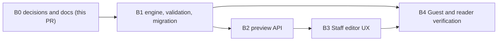

# Promotions DEC-077 — Implementation Plan (B1–B4)

Status: **Accepted plan (Product Owner, 2026-11-26) — documentation only (milestone B0).** Nothing in this file is implemented,
migrated or deployed. Decision: `docs/00-product/PROJECT_DECISIONS.md` DEC-077. Domain contract:
`docs/01-domain/PROMOTIONS_SPEC.md` "Amendment DEC-077". Worked numbers: `docs/01-domain/PROMOTIONS_STACKING_EXAMPLES.md` §10–§13.
Storage: `docs/02-technical/DATABASE_SPEC.md` "Amendment 2026-11-26". API: `docs/02-technical/API_CONVENTIONS.md` #111 (planned notes).

**Label note.** B1–B4 here are the DEC-077 follow-up milestones. They are unrelated to the DEC-075 milestones of the same names
described in `UNIFIED_PROMOTIONS_IMPLEMENTATION_PLAN.md` (engine, order integration, Staff workspace, Guest display), which are
already on `main`. Reference these as "DEC-077 B1" … "DEC-077 B4" in branches, PR titles and commits.

Every milestone is its own branch, its own PR, its own review and QA, and none is merged or deployed by another. The opt-in
`PROMOTIONS` entitlement is unchanged, so only restaurants that already have it are affected.

---

## 1. Baseline (`main` `02a000c`, verified by reading the code)

- `promotion-engine.ts` marks a CATEGORY / MENU promotion that is not `PERCENTAGE` as `INVALID_CONFIGURATION` and computes item
  candidates with `'PERCENTAGE'` hard-coded.
- `validatePromotionInput` rejects fixed item scope (`ITEM_SCOPE_REQUIRES_PERCENTAGE`) and accepts a CART `minimumSubtotal` of
  `null` or ≥ 0.
- The migration `20261128100000_unified_promotions` has CHECKs `promotions_item_scope_percentage_only`,
  `order_promotions_item_scope_percentage_only` and `promotions_minimum_subtotal_shape` (`>= 0`).
- `PromotionPreviewService` runs the real engine on a first-active-size, no-extras sample with the draft treated as ACTIVE, returns
  one result, and answers an invalid draft with `422`. The web `savings-preview.ts` additionally computes an *illustrative*
  example with browser BigInt arithmetic.
- The Staff editor hides the discount type for CATEGORY / MENU (`isPercentageOnly`), shows the minimum as optional, and places
  priority inside the "Schedule and tie-break" disclosure.
- Not verified here (to be confirmed inside the milestone that touches it): Guest readers of `order_promotions` outside the files
  listed in `UNIFIED_PROMOTIONS_HISTORICAL_SNAPSHOTS.md` §3; the Guest `ItemPromotionLabel` already branches on `type`.

## 2. Superseded DEC-075 restrictions and code touchpoints

| # | Superseded restriction | Touchpoints to change | Milestone |
| --- | --- | --- | --- |
| S1 | CATEGORY / MENU percentage only | `promotion-engine.ts` (item candidate type, `INVALID_CONFIGURATION` guard, `ITEM_SCOPE_REQUIRES_PERCENTAGE`), `promotion-engine.spec.ts`, new migration dropping the two CHECKs, `unified-promotions-integrity-postgres.e2e-spec.ts`, `web/src/lib/promotions/draft.ts` and `PromotionEditor.tsx` (`isPercentageOnly`), docs listed in DEC-077 | B1 (API, DB), B3 (editor) |
| S2 | CART minimum optional | `validatePromotionInput` and `PromotionsService` (create / patch / activate), `promotion-config.ts` (metadata-only comparison, `needsMinimumSubtotal`), DTO / OpenAPI, editor field | B1 (API), B3 (editor) |
| S3 | Preview = sample + browser illustration | `promotion-preview.service.ts`, `promotion-preview.dto.ts`, `web/src/lib/promotions/savings-preview.ts`, `SavingsPreview.tsx` | B2 (API), B3 (UI) |
| S4 | Priority visible beside schedule | `PromotionEditor.tsx`, `lib/i18n/messages/promotions.ts` | B3 |
| S5 | Preview optional / formula cards | covered by S3; remove formula-style strings | B2, B3 |

Not changed by this series: maximum savings first, non-stacking, tie-breaking, `PRICE_CHANGED`, the Delivery Zone minimum, Offers,
the `PROMOTIONS` entitlement and permissions, order idempotency fingerprint (no new Guest input is introduced).

## 3. Implementation sequence

B1 must merge first. B2 needs B1 (it previews fixed item scope and the minimum rule). B3 needs B1 and B2. B4 verification needs B1
and finishes after B3 so the full flow can be exercised.

## 4. B1 — Engine, validation and storage

**Scope.** Backend only plus one migration; no UI.

- Engine: item candidates use the promotion's own discount type; the unit saving is `min(value, original unit price)` for
  FIXED_AMOUNT (reuse the existing capped unit-discount helper) and half-up percentage otherwise; remove the fixed-item
  `INVALID_CONFIGURATION` guard. Selection, tie-breaking and strategy code is untouched.
- Validation: remove `ITEM_SCOPE_REQUIRES_PERCENTAGE`; add `MINIMUM_SUBTOTAL_REQUIRED` and `MINIMUM_SUBTOTAL_NOT_POSITIVE` for CART.
  The pure validator stays pure: the service passes whether the positive-minimum rule applies (always for a create; for a patch only
  when the normalized resulting configuration differs from the stored one in a non-metadata field; always for activation).
  Metadata fields are `internalName` and translations. A shared pure helper compares stored vs. requested normalized values.
- Read model: add `needsMinimumSubtotal`.
- Migration: one new forward SQL migration (name per the repository timestamp convention) with exactly two `DROP CONSTRAINT`
  statements. No `UPDATE`, no `INSERT`, no new CHECK, no trigger. Do not edit `20261128100000_unified_promotions`.
- Snapshot mapper and order pricing: confirm `buildOrderPricingSnapshot` / `checkOrderPricingSnapshot` accept FIXED item rows
  (`amount` ≤ `value × units`); fix only if a test proves an assumption.
- Public menu `itemPromotion`: confirm `type: FIXED_AMOUNT` and `amountOff` for CATEGORY / MENU.

**Migration and rollout.**

1. Backup first (`DEPLOYMENT_ARCHITECTURE.md`); apply with `prisma migrate deploy`, never `db push`.
2. Record the read-only legacy count query of `DATABASE_SPEC.md` for each environment in the PR; no data is changed on any outcome.
3. Order: apply the migration, then deploy the API (an API that creates fixed item rows must not run against a database that still
   has the CHECKs). The old API against the new schema is safe (it ignores fixed item rows as `INVALID_CONFIGURATION`).
4. Rollback: roll the application back only after deactivating any fixed item-scope promotions; do not re-add the two CHECKs once
   fixed rows exist (`DATABASE_SPEC.md` Amendment 2026-11-26 §3).

**Backward compatibility.** Existing promotions, orders, `order_promotions` and allocations are untouched and read exactly as
before. A legacy ACTIVE CART promotion keeps applying. The API changes are additive (`needsMinimumSubtotal`, two problem codes,
one removed problem code); clients that send full forms keep working because unchanged values are not changes.

**Tests (required).**

- Engine unit: every §10 example of the stacking examples; cap at original price against a legacy discount; fixed vs percentage
  ties; per-size `discountApplies`; zero price; item-vs-cart strictness; fixed item allocations reconcile; existing 64 engine
  cases and the snapshot specs still pass unchanged.
- Validator unit: every §11 create row; the matrix of legacy operations (metadata-only, whole-form re-send, each pricing /
  eligibility / priority change, activation, deactivation, archive, `0.00`, positive minimum supplied alongside a change).
- Real PostgreSQL e2e (`apps/api/test/*postgres*`): migration applies on a database that already has fixed-less data; a fixed
  CATEGORY and MENU promotion can be inserted; `value > 0` and `percentage ≤ 100` CHECKs still hold; a legacy CART row with
  NULL / 0.00 minimum survives a rename, deactivate and archive; no migration statement touches existing rows; end-to-end order
  with a fixed item promotion persists reconciling rows; a pre-B1 order still reads unchanged; tenant isolation (cross-restaurant
  target and promotion ids) and Branch scope unchanged; concurrent checkout locking spec unchanged.
- API contract: `PROMOTION_INVALID` envelopes, `needsMinimumSubtotal`, `409` behaviors unchanged; OpenAPI regenerates.

**Done when** all of the above pass, the migration is shown applied from scratch and over a populated database, and the PR
states the legacy counts and the rollback caveat.

## 5. B2 — Preview contract

**Scope.** Backend preview service and DTO only (contract in `API_CONVENTIONS.md` #111 "B2").

- States REAL / ILLUSTRATIVE / INCOMPLETE; INCOMPLETE returns `200` with `problems[]` and no money.
- Examples: QUALIFYING and BELOW_THRESHOLD for CART, QUANTITY and DELIVERY minimums; SINGLE for item scopes; `omittedExamples`
  with a reason when no basket can fall below the threshold.
- Applicable products (bounded) and assumptions; optional `sampleProductId`; `requestId` echo, `evaluatedAt`,
  `branchLocalDate`; `Cache-Control: no-store`.
- ILLUSTRATIVE samples are Backend-held constants evaluated by `evaluatePromotions`; no browser arithmetic is needed any more.
- Keep the current top-level response fields during B2 (additive change). No schema change, no new permission, no write.
- Basket construction is deterministic (stable product order, minimum units that reach / miss the threshold) and uses the same
  candidate loading, Branch date and RepeatableRead isolation as today. The draft is validated with the B1 rules, so a CART draft
  without a minimum is INCOMPLETE, while an unchanged legacy draft is previewable and returns a legacy notice flag.

**Backward compatibility.** Old editor keeps working until B3 because existing fields are unchanged.

**Tests (required).** Service tests for every §12 row (including the single-unit-exceeds case, competition `LOST_TO_BETTER_OFFER`,
zone-minimum shortfall, DELIVERY minimum pair); determinism (same input, same examples); INCOMPLETE returns no money; every
amount equals a direct `evaluatePromotions` call on the same lines (the preview never recomputes); tenant, Branch-grant and
inactive-Branch / foreign-zone / foreign-product rejection unchanged; no database writes (assert no row changes);
`requestId` echo; headers.

## 6. B3 — Staff editor UX

**Scope.** `apps/web` Staff promotions editor and workspace; no API or schema change beyond consuming B1 / B2.

- Plain-language sentences (EN / AR) replacing formula-like copy, from the i18n messages; remove browser illustration math
  (`savings-preview.ts` keeps only request building and display helpers; retire its arithmetic and its tests).
- Scope-specific controls (D4.2); discount type selector for every scope; CART minimum required with a legacy notice
  (`needsMinimumSubtotal`); preview card renders REAL / ILLUSTRATIVE / INCOMPLETE, the applicable products, and the paired
  below-threshold / qualifying examples.
- Stale protection: debounce, `AbortController`, send `requestId`, accept only the matching echo, dim while loading, clear on
  failure, re-request after save / activate, announce status politely (`aria-live`).
- Advanced settings: collapsed `
`; priority moves there from the schedule section, which stays visible as its own
  section; the saved value is always sent back unchanged unless edited; collapsed summary indicates a non-default priority.
- Preserve responsive layout (preview beside the form on wide screens, below on narrow), RTL / LTR with LTR-isolated numbers and
  currency, existing design tokens, 44 px targets, visible focus, reduced motion.

**Tests (required).** Existing `workspace.contract.test.mjs` updated; unit tests for draft building (priority unchanged on
load → save; fixed type allowed for CATEGORY / MENU; CART minimum required, legacy notice) and for the stale-response guard; the
Playwright staff scenarios under `apps/web/e2e/promotions-b4` extended: create fixed CATEGORY and MENU, create CART with and
without a minimum, legacy rename / deactivate / archive / change-value-refused / activate-refused, priority collapsed and
unchanged after save, three preview states, both threshold examples, rapid typing never shows an old answer. Manual QA matrix
(recorded in the PR): Arabic and English, RTL and LTR, mobile 360 px and desktop, 200 % text zoom, keyboard-only, screen-reader
status announcements, reduced motion. Accessibility is tested, not claimed as compliant.

## 7. B4 — Guest, readers and end-to-end QA

**Scope.** Verification first; code changes only where a reader proves wrong.

- Guest menu / product sheet / cart / confirmation render fixed item-scope promotions from `itemPromotion` and the server quote
  (label branches on `type`, never assumes percent; amounts as LTR runs in RTL).
- Reader audit of everything that prints an order promotion (`UNIFIED_PROMOTIONS_HISTORICAL_SNAPSHOTS.md` §3: Staff order detail
  and receipt, table-session bill / drawer, dashboard, WhatsApp message, Guest confirmation, AI `list_active_promotions` output)
  so a FIXED item row shows the amount, not "N %".
- Financial reconciliation: Guest quote = order total = Staff detail = receipt = WhatsApp message; identities of
  `DATABASE_SPEC.md` hold; `PRICE_CHANGED` still triggers when a promotion is edited between quote and submit.
- Legacy: a legacy CART promotion keeps pricing identically before and after the whole series.

**Tests (required).** Playwright Guest flow with a fixed CATEGORY and a fixed MENU promotion across the cart, quote, order and
tracking; order-pricing postgres e2e with fixed item winners (cap, qty > 1, mixed with legacy Product discount, cart-vs-item
strictness) reconciling to the cent; AI Tool scope / fabricated-promotion eval unaffected (read-only tool returns engine data);
visual QA matrix as in B3 for Guest screens.

## 8. Release gates and non-goals

- Each PR: documentation updated only where behavior changed; relevant checks run and named; no unrelated formatting.
- B1 is the only milestone with a migration. B2–B4 must not change the schema.
- Deployment stays a separate decision per milestone. Do not resume the Kitchen K2 track from this series.
- Out of scope: coupons, BOGO, Combos, per-customer limits, stacking beyond the existing rule, changing the default priority 100 or
  any stored priority, automatic repair of legacy CART promotions, new feature flags.

## 9. Risks to watch

- A fixed amount shown as "15" without the currency in Guest labels (B4 audit).
- Preview samples that are not representative of paid extras for CART: the preview must state "without extras" (assumptions).
- The ordering of migration and API deploy in B1 (step 3 above).
- Legacy detection depends on every CART write going through the service; any future direct data fix must keep it true.
